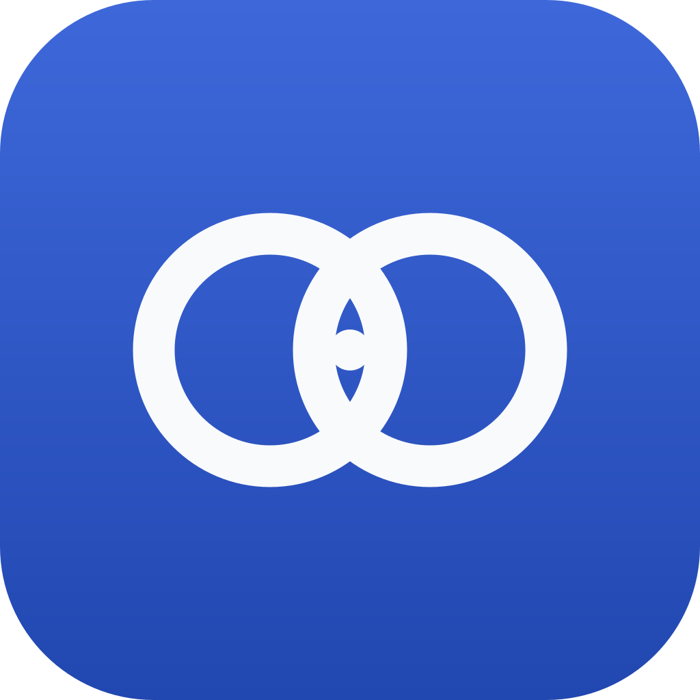
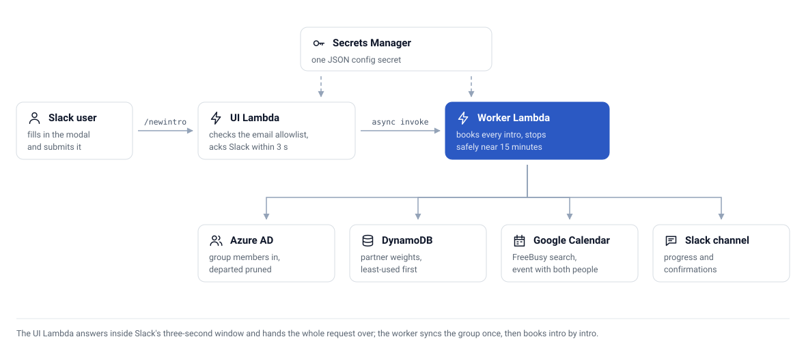

<div align="center">



# 🤝 New Starters MeetUp

**Book every new starter's coffee and buddy intros with one Slack command: it picks the least-used partner and a free Google Calendar slot**


[](https://github.com/CaputoDavide93/New-Starters-Meetup/actions/workflows/ci.yml)

</div>

---

## ✨ Features

Type `/newintro` in Slack, paste the email addresses of your new starters, and
the bot books a 15-minute coffee chat or buddy intro for each one in Google
Calendar. It is for the person who coordinates onboarding and is tired of
doing the diary work.

### Why it exists

Booking intros for a cohort by hand means opening three calendars per meeting,
finding a gap, and trying to remember who did a coffee chat last week. The same
few friendly people end up doing most of them.

The bot does the searching and the counting. One Google FreeBusy call checks the
team calendar, the new starter and the partner together, the first free slot
gets booked, and every booking is counted so the next partner is someone who
has done fewer.

| | New Starters MeetUp | Booking by hand | Scheduling-link tools |
|---|---|---|---|
| Finds a slot free for the team calendar, the new starter and the partner | Yes, one FreeBusy call | You compare calendars yourself | Each person picks a time themselves |
| Chooses the partner | One of the least-used, picked at random among ties | Whoever comes to mind | You assign partners elsewhere |
| Keeps meetings spaced out | Two business days apart per person | You track it | You track it |
| Pool of partners | An Azure AD group, synced on every request | A list you maintain | A list you maintain |
| Where it runs | Two AWS Lambdas you deploy | Nowhere | A hosted service |
| Setup effort | Slack app, Azure AD app, Google service account, AWS | None | Account sign-up |

The trade-off: you deploy and run the AWS, Slack, Azure AD and Google Workspace
side yourself, and the booking window, time zone and lunch break live in code,
not in a settings page. [How it works](docs/how-it-works.md) has the details.

### Install in 3 steps

You need an AWS account, a Slack app, an Azure AD app registration and a Google
Workspace service account with domain-wide delegation. See
[Prerequisites](#-prerequisites).

1. **Build the packages.** `./scripts/build.sh` writes the two function ZIPs and the dependency layer into `dist/`.
2. **Deploy and configure.** Publish the layer, create the two Lambdas and the two DynamoDB tables, then store your settings in one Secrets Manager secret. [Setup guide](docs/setup.md).
3. **Point Slack at it.** Set the `/newintro` command's request URL to the UI Lambda's URL, then run `/newintro` in a channel.

Steps 2 and 3 need real AWS, Slack, Azure AD and Google accounts, so no check
here covers them. See [Tested and unverified](#-tested-and-unverified).

| | Feature | What it does for you |
|---|---|---|
| ⚡ | `/newintro` slash command | Opens a Slack modal to book Coffee ☕️ or Buddy 🤝 intros for a list of emails |
| 🪪 | Azure AD group sync | Keeps the partner pool current from a group, and removes departed people from the database |
| ⚖️ | Fair partner picking | DynamoDB counts each partner's intros, and the next pick comes from those with the fewest |
| 📅 | Calendar-aware booking | One Google FreeBusy call finds a free 15-minute slot, 11:00 to 15:00 on weekdays, lunch excluded |
| 🔁 | Business-day cadence | Spaces one person's meetings two business days apart, skipping weekends |
| 💬 | Live status updates | Posts progress, a line per booking and a final summary to the channel |
| 🛡️ | Domain allowlist | Only addresses on your allowed domains can be booked, checked in the modal and again in the worker |
| 🙈 | No emails in logs | CloudWatch lines carry short hashed refs (`user:1a2b3c4d`) instead of addresses |
| 🔄 | Resilient Graph sync | Microsoft Graph calls time out after 30 s and retry throttling and 5xx errors with backoff |
| 🚫 | Missing-calendar skip | A partner whose calendar cannot be read is skipped instead of failing the booking |
| ☁️ | Serverless | Two ARM64 Lambdas and a shared layer, nothing to keep running |

---

## 🗺️ Architecture

<picture>
  <source media="(prefers-color-scheme: dark)" srcset="docs/assets/architecture-dark.svg">
  
</picture>

A thin **UI Lambda** answers Slack inside its 3-second window. A **Worker
Lambda** does the slow booking work asynchronously. [How it works](docs/how-it-works.md)
follows one request through both. `tools/gen_diagram.py`
draws the diagram; CI runs it with `--check`.

---

## 📋 Prerequisites

| Requirement | Notes |
|-------------|-------|
| Python | 3.13 (matches the Lambda runtime) |
| AWS account | Lambda, Secrets Manager, DynamoDB, CloudWatch Logs |
| Slack app | Bot token, signing secret, and a `/newintro` slash command |
| Azure AD app | Client credentials with permission to read group members |
| Google service account | Domain-wide delegation for Calendar FreeBusy and event creation |

---

## ⚙️ Configuration

Two environment variables select the config; everything else lives in one JSON
secret.

| Variable | Lambda | Required | Description |
|----------|--------|:--------:|-------------|
| `CONFIG_SECRET` | both | ✅ | ARN of the Secrets Manager secret holding the JSON config |
| `WORKER_FUNCTION_NAME` | UI | ✅ | Name of the worker Lambda to invoke asynchronously |
| `LOG_LEVEL` | worker | ❌ | Python log level (default `INFO`) |

The secret's keys, the DynamoDB table layout and the IAM permissions are in
[docs/setup.md](docs/setup.md#3-store-the-configuration). [.env.example](.env.example)
is the template.

---

## 📖 Usage

1. In Slack, run **`/newintro`** in a channel the bot can post to.
2. Fill in the modal: intro type (☕️ Coffee or 🤝 Buddy), participant emails, start date, meetings per person.
3. Submit. The UI Lambda acknowledges at once and the worker posts progress as it books:

```text
☕ Booking Coffee…
✅ Jane.Doe ↔ John.Smith — 14 Jul 11:00
✅ Booking complete! 2 succeeded, 0 failed.
```

Emails outside `allowed_email_domains` are flagged in the modal and nothing is
booked. `scripts/cleanup_db.py` merges duplicate DynamoDB records caused by email
case mismatches; see [Troubleshooting](docs/troubleshooting.md).

---

## ✅ Tested and unverified

| Area | Status | What was run |
|------|--------|--------------|
| Allowlist, log redaction, UI handler, booking flow | Tested | The pytest suite (`make test`), with Secrets Manager, Slack, Google and Graph stubbed, Python 3.13 on macOS and in CI on Ubuntu |
| Lint and diagrams | Tested | `ruff` and `tools/gen_diagram.py --check` in CI |
| Build | Tested | `./scripts/build.sh` on macOS produced all three ZIPs from the hash-pinned lock |
| Slack modal rendering, `/newintro` against a live workspace | Unverified | No check opens Slack |
| Azure AD group sync against a real tenant | Unverified | Graph is stubbed |
| Google Calendar FreeBusy and event creation | Unverified | Google is stubbed |
| Deployment on AWS Lambda, DynamoDB reads and writes | Unverified | No check calls AWS |

There are no screenshots: the only interface is a Slack modal, and no check
renders it. A Block Kit preview would not show this product.

---

## 📁 Repo structure

```text
New-Starters-Meetup/
├── src/
│   ├── common/               # 🧠 shared code, shipped in the layer as `intro_common`
│   │   ├── config.py         # 🔐 Secrets Manager loader
│   │   ├── azure_sync.py     # 🪪 Azure AD group sync
│   │   ├── calendar_utils.py # 📅 Google Calendar FreeBusy + events
│   │   ├── dynamo_utils.py   # 🗄️ DynamoDB weight management
│   │   └── emails.py         # 🛡️ email allowlist parsing + hashed log refs
│   ├── ui_lambda/
│   │   └── ui_entry.py       # 🎛️ Slack slash command + modal handler
│   └── worker_lambda/
│       └── worker_entry.py   # ⚙️ booking engine
├── tests/                    # 🧪 pytest suite
├── tools/
│   ├── gen_diagram.py        # 🎨 draws the architecture diagram (stdlib only)
│   └── brand/                # 🖌️ icon and social-preview generator
├── docs/                     # 📚 setup, how it works, troubleshooting, FAQ
│   └── assets/               # 🖼️ diagram, icon, social preview
├── scripts/
│   ├── build.sh              # 🔧 builds the three deployment ZIPs into dist/
│   └── cleanup_db.py         # 🧹 DynamoDB duplicate-user cleanup
├── Makefile                  # 🧰 venv, test, lint, check, build
├── llms.txt                  # 🤖 one-page summary for AI search
├── requirements.in           # 📦 top-level layer deps
├── requirements.txt          # 🔒 hash-pinned lock used by build.sh
├── .github/                  # 🤖 CI workflow and dependabot config
├── .env.example              # ⚙️ Lambda environment template
└── README.md  CONTRIBUTING.md  SECURITY.md  AGENTS.md  LICENSE
```

`build/`, `deploy/` and `dist/` are created by `scripts/build.sh`, gitignored,
never edited by hand.

---

## 🧪 Testing

```bash
make venv     # Python 3.13 environment with the locked dependencies
make check    # ruff, pytest, diagram and icon checks
```

`make check` is what CI runs. Dependencies are declared in `requirements.in` and
locked with hashes in `requirements.txt`; the re-lock command is at the top of
`requirements.in`.

---

## 🛠️ Troubleshooting

Fixes by symptom are in [docs/troubleshooting.md](docs/troubleshooting.md), short
answers in [docs/faq.md](docs/faq.md).

---

## 🤝 Contributing

The setups I could not test (other Azure tenants, calendars, regions) make the
most useful reports. Open an issue with the diagnostics listed in
[CONTRIBUTING.md](CONTRIBUTING.md#-reporting-an-untested-setup), or send a pull
request. Report vulnerabilities privately; see [SECURITY.md](SECURITY.md).

---

## 📄 License

MIT. See [LICENSE](LICENSE).

---

<p align="center"><sub>Made with ❤️ by <a href="https://github.com/CaputoDavide93">Davide Caputo</a></sub></p>
